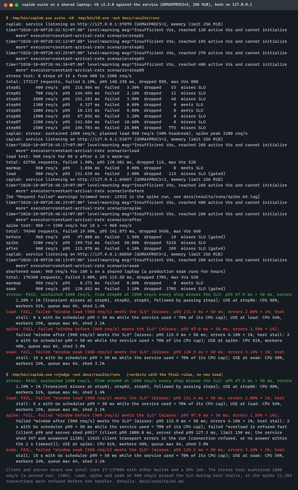
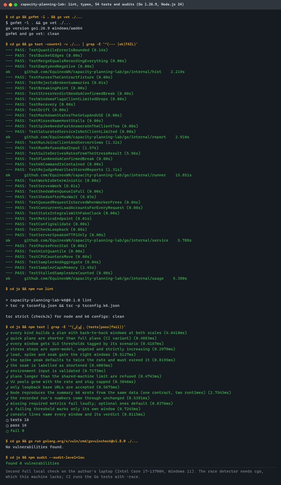
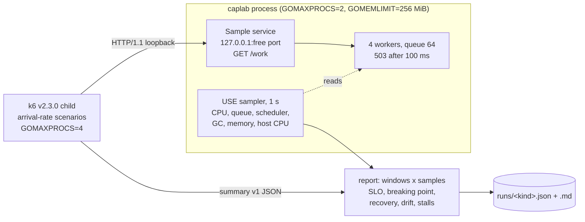
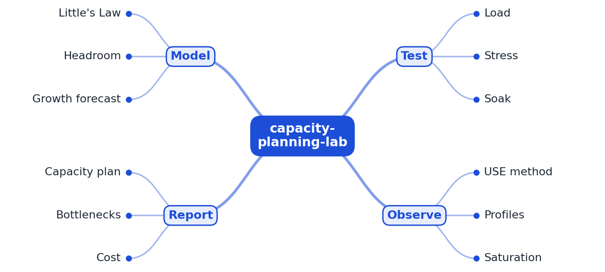

# capacity-planning-lab

[](https://github.com/EquinoxWN/capacity-planning-lab/actions/workflows/ci.yml)


> Answers 'how many servers will we need?' with evidence: load-test a service to its breaking point and write the capacity plan.

Part of my **Backend and API** list · Go · JavaScript

## Proof it works

One command runs k6 stress, load, spike and soak tests against the sample service. Every run
reports the client's latency and errors next to the service's utilization, saturation and errors
(the USE method). The stress test found the breaking point at 1900 req/s (sustained: 1600 req/s,
with the service's two CPUs at 88% and its queue full). The same suite also shows why a
shared laptop is not a capacity lab. Host stalls failed the longer load, spike and soak windows,
and in the spike 12,383 connections were refused before the service's own load shedding could
answer them:



54 tests pass, the k6 scripts type-check in strict mode, and govulncheck and npm audit find
nothing:



## Architecture

**What M1 runs today:**



**Full roadmap (M1 to M3):**



## How it works

_Steps 1 and 2 are built and tested (M1); the rest is on the [roadmap](#roadmap)._

1. k6 runs load, stress, spike and soak tests against a sample service.
2. Resources are checked with the USE method: utilization, saturation and errors.
3. Profilers locate the top bottlenecks, and each fix is re-measured.
4. Little's Law links throughput, latency and concurrency to size pools and replicas.
5. A growth forecast estimates when current capacity runs out.
6. A written plan states limits, headroom, cost and recommended changes.

## Who it helps

- **Who:** backend and platform engineers who have to size a service or defend a capacity
  number, and anyone learning to load test without fooling themselves.
- **The problem:** a load test run carelessly gives a confident wrong number: the load slows down
  with the service, the load generator is the real bottleneck, a noisy neighbour takes the CPU,
  or "max throughput" has no latency target.
- **What M1 does:** it steps the arrival rate up until the SLO breaks for good, then checks the
  planned load, a spike and a shortened soak at rates derived from that. Each window gets client
  latency and errors, the service's CPU, worker, queue, memory and scheduler numbers, the host CPU
  and the load generator's own CPU. It flags client-limited windows and host stalls instead of
  blaming the service.
- **How to use it:** run `make bench` (or `caplab suite`) and read `docs/results/runs/*.md`. To test
  your own HTTP service, point the k6 scripts at a loopback `BASE_URL` and reuse the profiles,
  thresholds and summary format.

## Tech stack

| Area | In M1 | Planned |
|---|---|---|
| Load | k6 v2.3.0 (checksum-verified download), arrival-rate scenarios with per-window SLO thresholds, load, stress, spike and shortened soak profiles | Longer steps and repeated runs on a dedicated machine |
| Service | Go 1.26 standard library: bounded worker pool, `503` load shedding, `/metrics` in Prometheus format, loopback only | Connection limits in front of the handler (M2) |
| Observe | In-process USE sampler: OS CPU counters, `runtime/metrics`, latency histograms, time-weighted queue and worker occupancy, host-stall detection | pprof profiles (M2), Prometheus and Grafana |
| Analysis | Go: strict summary contract, breaking point, recovery, drift, client-limited and stall checks, `rejudge` | Little's Law sizing (M2), growth forecast and capacity plan (M3) |
| Quality | go vet, gofmt, tsc 7 strict `checkJs`, Go and Node tests, govulncheck, npm audit, CI quick suite | |

Languages: **Go** (service, sampler, runner, analysis) and **JavaScript** (k6 scripts, type-checked).

| Path | What it is |
|---|---|
| `go/cmd/caplab` | CLI: `serve`, `run <kind>`, `suite`, `rejudge` |
| `go/internal/service` | Sample service: `/work`, `/healthz`, `/metrics`, bounded pool, loopback check |
| `go/internal/usage` | USE sampler, OS CPU counters (Windows and Linux), window aggregation |
| `go/internal/hist` | Log-bucket latency histogram, at most 9.06% over the true quantile |
| `go/internal/report` | k6 summary contract, verdicts, Markdown with the USE table |
| `go/internal/runner` | Runs the service and k6, the suite, and `rejudge` |
| `js/k6` | `load.js`, `stress.js`, `spike.js`, `soak.js` and their shared `lib/` |
| `testdata/contract` | The summary k6 wrote in a real run; both languages test against it |
| `scripts/get-k6.sh` | Downloads k6 into `.tmp/bin` and checks its SHA-256 |

## Run it

Needs Go 1.26+, Node.js 24+, make, and bash with curl (Git Bash on Windows). Everything is downloaded
into git-ignored folders inside the repository.

```bash
make setup   # npm ci (TypeScript and type definitions for the checks)
make k6      # k6 v2.3.0 into .tmp/bin, checked against pinned SHA-256 values
make lint    # gofmt, go vet, tsc strict
make test    # Go tests (race detector) and Node tests
make audit   # govulncheck and npm audit
make e2e     # quick suite as in CI, about 2 minutes
make bench   # full suite into docs/results/runs, about 8 minutes
```

Or step by step:

```bash
make build
.tmp/bin/caplab run -k6 .tmp/bin/k6 -out .tmp/runs stress              # one test
.tmp/bin/caplab run -k6 .tmp/bin/k6 -out .tmp/runs -rate 900 load      # planned load
.tmp/bin/caplab serve -addr 127.0.0.1:8080                             # service alone
k6 run -e BASE_URL=http://127.0.0.1:8080 -e SCALE=quick js/k6/spike.js # k6 alone
```

Flags cap both sides: `-procs` and `-mem-mib` for the service, `-client-procs` for k6. Runs refuse
non-loopback addresses and plans over 600 s. Client and server share the machine; every report
says so.

## Tests and results

Latest local run (full detail in [docs/results/m1.md](docs/results/m1.md)):

| Test file | Tests | What it proves |
|---|---|---|
| `go/internal/hist/hist_test.go` | 4 | Quantile error bound (never under, at most 9.06% over), bucket edges, merge, empty input |
| `go/internal/service/service_test.go` | 11 | Work, shedding on a full queue and after the max wait, queued service, 200 concurrent requests all counted, occupancy integrals, metrics, config bounds, loopback only, HTTP/1.1 only |
| `go/internal/usage/usage_test.go` | 6 | CPU counters move, `/proc/stat` parsing, runtime histograms, sampling and aggregation, memory cap, stall detection |
| `go/internal/report/report_test.go` | 11 | Contract fixture, 13 broken summaries refused, breaking-point rules, verdicts, client-limited and saturated windows, recovery, drift, stalls, spike client check, Markdown |
| `go/internal/runner/runner_test.go` | 6 | End-to-end run with a fake load generator, refused inputs, suite rate derivation, planning rule, contained k6 environment, rejudge |
| `js/test/profiles.test.js` | 11 | Windows, thresholds, executors, gating, spike and soak rules, input validation, length limit, VU pools, loopback URLs |
| `js/test/summary.test.js` | 5 | Node reproduces k6's own summary byte for byte; recorded numbers; failures; console lines |

| Check | Result |
|---|---|
| Tests | 54 passed, 0 failed (38 Go, 16 Node) |
| Lint and types | gofmt, go vet, tsc strict `checkJs`: clean |
| Audits | govulncheck v1.8.0 (Go 1.26.9): no vulnerabilities; npm audit: 0 |
| Stress, sustained rate (service at GOMAXPROCS=2) | 1600 req/s in 4 of 5 runs, 1300 in one; breaking point 1900 req/s |
| USE at the breaking point | CPU 88% of 2 CPUs, scheduler p99 59 ms, queue 64 of 64, 1.4% shed; workers 51% busy, memory 16% of 256 MiB |
| Load, spike, soak at 960 req/s (final suite) | missed the SLO: 8, 2 and 18 s of host stalls; spike 12,383 connections refused before the handler |
| Recovery after the spike (server samples) | 0.0 s in the final suite (its after window still missed the SLO on the client side during host stalls), 0.2 s in the earlier suite |
| Soak drift (180 s, shortened) | heap x0.83, goroutines x0.53: no growth |
| Load generator | 10% to 18% of its CPU cap; peak 461 MiB |

CI runs lint, tests with the race detector, both audits and the quick suite on every push.

## Roadmap

**M1** (≈8 h)
- [x] Write `docs/rfc/0001-design.md`: problem, goals, non-goals, chosen design
- [x] k6 runs load, stress, spike and soak tests against a sample service.
- [x] Resources are checked with the USE method: utilization, saturation and errors.

**M2** (≈8 h)
- [ ] Profilers locate the top bottlenecks, and each fix is re-measured.
- [ ] Little's Law links throughput, latency and concurrency to size pools and replicas.

**M3** (≈9 h)
- [ ] A growth forecast estimates when current capacity runs out.
- [ ] A written plan states limits, headroom, cost and recommended changes.
- [ ] Publish the proof below with real numbers

Found during M1 and carried forward: overload in front of the handler (connection refusals in the
spike) and host interference on a shared machine.

## Proof

What this repo must show before it counts as done:

- The capacity plan document itself, which is exactly the artifact Staff engineers are expected to write.

| Result | Value |
|---|---|
| M3 capacity plan | Not written yet (M3). Current M1 numbers: see [Tests and results](#tests-and-results). |

## Why it matters

- **Interview angle:** 'How many servers will we need next year?'
- **Upstream I'd like to contribute to:** Grafana k6 extensions or docs.

## Design docs

- [RFC 0001: design](docs/rfc/0001-design.md)
- [ADR 0001: record architecture decisions](docs/adr/0001-record-architecture-decisions.md)
- [ADR 0002: run the service and the USE sampler inside the runner process](docs/adr/0002-service-and-sampler-in-the-runner-process.md)
- [ADR 0003: drive load with arrival-rate executors (open model)](docs/adr/0003-open-model-arrival-rate-load.md)
- [ADR 0004: the breaking point is the start of persistent SLO misses](docs/adr/0004-breaking-point-is-the-start-of-persistent-misses.md)
- [M1 results](docs/results/m1.md)

## Scope

This is a learning and portfolio system, not a hosted production service. Everything runs locally,
on the loopback interface only, and the load generator shares the machine with the service.

## Security and contributing

- The service and the k6 scripts refuse non-loopback addresses; k6 runs without inherited `K6_*`
  variables, with usage reports and extension downloads off.
- k6 is pinned by version and SHA-256; every GitHub Action is pinned to a commit SHA; workflows run
  read-only, without persisted credentials.
- Dependabot update pull requests are paused (`open-pull-requests-limit: 0`) so the repository keeps a single `main` branch; dependencies are updated by hand and checked by the CI audit.
- `go vet`, gofmt, `tsc` strict and the race detector on every push; `govulncheck` and `npm audit`
  (`make audit`) in CI.
- Report vulnerabilities privately: see [SECURITY.md](SECURITY.md). To contribute, see [CONTRIBUTING.md](CONTRIBUTING.md).

## License

MIT, see [LICENSE](LICENSE).
